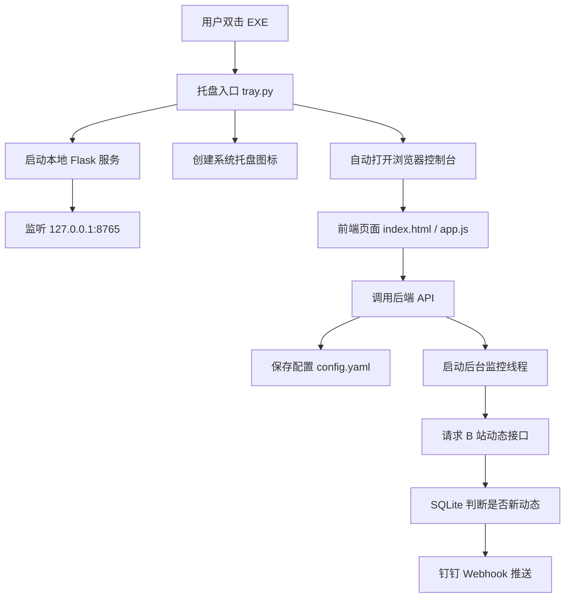

# B 站 UP 主动态钉钉监控项目技术实现详解

## 0. 这份文档的定位

这份文档不是简单记录“做了什么”，而是解释这个软件是如何从几个独立能力组合成最终可运行成果的。

最终软件看起来很简单：

```text
双击 EXE
右下角出现托盘图标
浏览器打开控制台
添加 UP
启动监控
新动态推送到钉钉
```

但背后实际由几层能力配合完成：

```text
系统托盘入口
  -> 本地 Web 服务
    -> 前端控制台
      -> 后端 API
        -> 配置文件
        -> B 站动态抓取
        -> SQLite 去重
        -> 钉钉机器人推送
```

本文会按“模块职责 + 数据流 + 关键代码逻辑 + 常见问题”的方式拆解。

最终交付文件：

```text
.\BiliDingTalkMonitor.exe
```

配置与运行数据目录：

```text
%APPDATA%\BiliDingTalkMonitor
```

该目录中通常包含：

```text
config.yaml
state.sqlite3
monitor.log
```

## 1. 总体架构

### 1.1 整体运行模型

这个软件本质上是一个“本地后台服务 + 浏览器控制台 + 托盘入口”的组合。



这种结构的好处：

- 不需要真正开发复杂桌面 UI。
- 前端用浏览器承载，交互更容易实现。
- EXE 负责启动服务和托盘常驻。
- 浏览器关闭后，后台线程仍在 EXE 进程内运行。

### 1.2 为什么不用纯网页

如果做成纯网页，会遇到几个问题：

- 网页不能长期稳定在后台轮询。
- 浏览器跨域限制会影响直接请求 B 站和钉钉。
- 关闭网页后程序就停了。
- Cookie、Webhook 等敏感信息不适合放到公开服务器。

因此采用本地服务：

```text
本机 EXE 运行
本地 Flask 提供控制台
所有配置保存在本机
请求 B 站和钉钉都由本地 Python 后端完成
```

### 1.3 为什么最终改成系统托盘

早期 EXE 版本会出现任务栏大图标。用户希望像后台工具一样隐藏到右下角。

因此最终入口从普通 Tk 窗口改成系统托盘：

```text
旧方式：EXE -> 显示一个桌面小窗口 -> 打开浏览器
新方式：EXE -> 只显示托盘图标 -> 打开浏览器
```

托盘版的关键点：

- 进程仍然运行。
- 不占用任务栏大图标。
- 通过右下角图标控制打开和退出。

## 2. 文件和模块职责

最终项目源码可以按下面方式理解。

```text
bili_dingtalk_monitor/
  config.py       配置读写和默认配置
  bilibili.py     B 站动态接口请求、WBI 签名、动态解析
  dingtalk.py     钉钉 Webhook 签名和消息发送
  store.py        SQLite 去重状态库
  formatter.py    把动态格式化成钉钉 Markdown
  monitor.py      监控核心：检查 UP、判断新动态、推送
  web.py          Flask 后端 API、本地控制台服务、后台线程控制
  tray.py         Windows 托盘入口、启动本地服务、打开浏览器
  templates/
    index.html    前端页面结构
  static/
    app.css       前端样式
    app.js        前端交互逻辑
```

每个模块只负责一类事情：

```text
tray.py      负责“程序如何启动和退出”
web.py       负责“网页控制台如何和后端交互”
monitor.py   负责“监控流程如何跑”
bilibili.py  负责“如何拿到 B 站动态”
dingtalk.py  负责“如何发钉钉消息”
store.py     负责“如何避免重复推送”
config.py    负责“配置保存在哪里、怎么读写”
```

这种拆分的价值是：如果以后 B 站接口变了，只主要改 `bilibili.py`；如果钉钉规则变了，只主要改 `dingtalk.py`；如果想换成飞书，新增一个类似 `feishu.py` 即可。

## 3. 启动入口：tray.py 如何让软件隐藏到右下角

### 3.1 启动后的第一件事

用户双击 EXE 后，实际执行的是托盘入口。

核心逻辑：

```python
server = TrayServer()
server.start()
```

`TrayServer` 做三件事：

1. 找一个本地可用端口，优先 8765。
2. 找到配置目录 `%APPDATA%\BiliDingTalkMonitor`。
3. 创建并启动 Flask 本地服务。

### 3.2 配置目录为什么放在 APPDATA

代码逻辑等价于：

```python
base = Path(os.environ.get("APPDATA"))
path = base / "BiliDingTalkMonitor"
path.mkdir(parents=True, exist_ok=True)
```

也就是：

```text
C:\Users\当前用户\AppData\Roaming\BiliDingTalkMonitor
```

这样设计有几个好处：

- EXE 可以随便放，不影响配置。
- 升级 EXE 不会丢配置。
- 不需要管理员权限。
- SQLite 状态库可以稳定写入。

### 3.3 本地端口如何选择

默认控制台地址是：

```text
http://127.0.0.1:8765
```

但如果 8765 被占用，程序会尝试 8766、8767 等端口。

逻辑等价于：

```python
for port in range(8765, 8765 + 50):
    if port_is_free(port):
        return port
```

这能避免因为端口被占用导致程序直接打不开。

### 3.4 托盘图标如何生成

托盘功能由 `pystray` 实现。

软件启动后会创建一个 64x64 的小图标：

```python
image = Image.new("RGBA", (64, 64), (0, 0, 0, 0))
draw.rounded_rectangle(...)
draw.polygon(...)
```

然后注册到系统托盘：

```python
pystray.Icon(
    APP_NAME,
    create_icon_image(),
    "B站动态钉钉监控",
    menu=pystray.Menu(
        pystray.MenuItem("打开控制台", open_console, default=True),
        pystray.MenuItem("退出", quit_app),
    ),
)
```

这就是为什么新版软件只在右下角出现小图标。

### 3.5 浏览器为什么可以关闭

浏览器只是访问本地控制台页面。

真正运行的是：

```text
BiliDingTalkMonitor.exe 进程
```

监控线程也在这个进程里。

因此：

```text
关闭浏览器：监控继续
退出托盘图标：监控停止
```

这是理解软件运行状态的关键。

## 4. 本地 Web 服务：web.py 如何连接前端和后端

### 4.1 Flask 服务负责什么

`web.py` 创建一个 Flask 应用，提供两类内容：

1. 静态页面：

```text
/
```

返回控制台页面。

2. API 接口：

```text
GET    /api/config
PUT    /api/config
POST   /api/ups
DELETE /api/ups/<mid>
POST   /api/test-dingtalk
POST   /api/poll-once
POST   /api/service/start
POST   /api/service/stop
GET    /api/status
```

前端页面所有按钮，本质上都是调用这些 API。

### 4.2 前端和后端如何通信

前端 `app.js` 中封装了一个通用请求函数：

```javascript
async function api(path, options = {}) {
  const response = await fetch(path, {
    headers: { "Content-Type": "application/json" },
    ...options,
  });
  const payload = await response.json();
  if (!response.ok || payload.ok === false) {
    throw new Error(payload.error || `请求失败：${response.status}`);
  }
  return payload;
}
```

例如点击“保存配置”时，前端调用：

```javascript
api("/api/config", {
  method: "PUT",
  body: JSON.stringify(readForm()),
})
```

后端接收 JSON 后写入 `config.yaml`。

### 4.3 为什么要提供 API，而不是前端直接改文件

浏览器网页不能直接稳定读写本机文件。

所以需要后端 API 作为中间层：

```text
前端输入框
  -> HTTP API
    -> Python 后端
      -> 写入 config.yaml
```

这种方式安全且可控。

### 4.4 后台监控线程如何启动

点击“启动后台监控”时：

```javascript
runAction("/api/service/start", "后台监控已启动")
```

后端对应：

```python
@app.post("/api/service/start")
def start_service():
    controller.start()
    return jsonify({"ok": True})
```

`controller.start()` 会创建后台线程：

```python
self.thread = threading.Thread(target=self._loop, daemon=True)
self.thread.start()
```

从这一刻开始，即使浏览器关闭，线程也仍在 EXE 进程内继续运行。

### 4.5 后台线程如何停止

点击“停止”时：

```text
POST /api/service/stop
```

后端会设置：

```python
self.stop_event.set()
```

后台循环每轮等待时会检查这个事件。

这是比强行杀线程更安全的方式。

## 5. 配置系统：config.py 如何保存用户输入

### 5.1 配置文件结构

用户在前端填写的内容最终保存为 YAML。

典型结构：

```yaml
dingtalk:
  webhook: "https://oapi.dingtalk.com/robot/send?access_token=..."
  secret: "SEC..."
  keyword: "B站动态"

bilibili:
  cookie: "SESSDATA=...; bili_jct=..."
  user_agent: "Mozilla/5.0 ..."
  timeout_seconds: 15

monitor:
  notify_existing_on_first_run: false
  poll_interval_seconds: 60
  state_db: "state.sqlite3"
  log_level: "INFO"

ups:
  - mid: "123456"
    name: "示例UP"
```

### 5.2 为什么使用 YAML

YAML 的优点：

- 可读性比 JSON 好。
- 用户必要时可以手动编辑。
- 结构清晰，适合配置文件。

### 5.3 默认配置如何生成

首次启动时，如果配置文件不存在：

```python
ensure_config(config_path)
```

会写入默认配置：

```python
default_config_dict()
```

这样用户第一次打开控制台时，不需要手动创建任何文件。

### 5.4 配置如何转成 Python 对象

`config.py` 使用 dataclass 定义配置结构：

```python
@dataclass(frozen=True)
class DingTalkConfig:
    webhook: str
    secret: str
    keyword: str
```

类似地还有：

```text
BilibiliConfig
MonitorConfig
UpConfig
AppConfig
```

这样比直接到处传 dict 更清晰。

例如：

```python
config.dingtalk.webhook
config.bilibili.cookie
config.monitor.poll_interval_seconds
config.ups
```

代码含义非常直观。

## 6. B 站动态抓取：bilibili.py 的核心实现

### 6.1 使用的接口

软件主要请求 B 站空间动态接口：

```text
https://api.bilibili.com/x/polymer/web-dynamic/v1/feed/space
```

核心参数：

```text
host_mid=UP主mid
timezone_offset=-480
features=itemOpusStyle
```

### 6.2 为什么不能直接裸请求

B 站接口会做风控和签名校验。

如果直接请求，常见错误是：

```text
code: -352
```

或 HTTP：

```text
412 Precondition Failed
```

因此软件做了几件事：

- 设置浏览器 User-Agent。
- 设置 Referer。
- 先访问 B 站首页预热 Cookie。
- 请求 nav 接口获取 WBI key。
- 对动态接口参数生成 WBI 签名。
- 支持用户填写登录 Cookie。

### 6.3 WBI 签名是什么

B 站部分 Web 接口需要参数中带：

```text
wts
w_rid
```

其中：

- `wts` 是当前时间戳。
- `w_rid` 是按 B 站规则生成的 MD5 签名。

软件先请求：

```text
https://api.bilibili.com/x/web-interface/nav
```

从返回中拿到：

```text
wbi_img.img_url
wbi_img.sub_url
```

再从 URL 中提取 key：

```python
img_key = extract_key_from_url(img_url)
sub_key = extract_key_from_url(sub_url)
```

然后用固定映射表混合：

```python
mixin_key = mixin_key(img_key, sub_key)
```

最终给动态接口参数签名：

```python
values = {**params, "wts": int(time.time())}
query = urllib.parse.urlencode(clean_values)
w_rid = md5(query + mixin_key)
```

### 6.4 Cookie 的作用

Cookie 决定软件以什么身份访问 B 站。

不填 Cookie：

```text
尽量访问公开动态
```

填写 Cookie：

```text
以该登录账号的权限访问动态
```

这会影响：

- 是否触发风控。
- 是否能看到登录后可见动态。
- 是否能看到充电权限内的动态。

但注意：

```text
软件不会绕过权限。账号看不到的内容，软件也不应该看到。
```

### 6.5 动态解析如何做

B 站动态返回结构比较复杂。不同动态类型字段不一样：

```text
视频动态 archive
专栏动态 article
图文动态 draw
新版图文 opus
普通文字动态 desc
转发动态 forward
```

程序做法是：

1. 先取动态 ID：

```python
dynamic_id = raw.get("id_str")
```

2. 取作者：

```python
modules = raw.get("modules")
author = modules.get("module_author")
```

3. 取动态主体：

```python
dynamic = modules.get("module_dynamic")
major = dynamic.get("major")
```

4. 按类型提取标题和摘要：

```python
archive -> 视频标题和简介
article -> 专栏标题和简介
opus    -> 图文标题和摘要
draw    -> 图文动态
desc    -> 普通动态正文
```

5. 生成统一结构：

```python
DynamicItem(
    dynamic_id=...,
    up_mid=...,
    up_name=...,
    title=...,
    summary=...,
    url=...,
    publish_time=...,
    raw_type=...,
)
```

统一结构的好处是：后续监控和推送不需要关心 B 站原始 JSON 多复杂。

## 7. 去重机制：store.py 如何避免重复推送

### 7.1 为什么必须去重

软件每隔一段时间检查一次动态。

如果不去重，同一条动态每一轮都会被推送。

因此必须记录哪些动态已经见过。

### 7.2 SQLite 表结构

本地 SQLite 数据库：

```text
state.sqlite3
```

表结构：

```sql
CREATE TABLE IF NOT EXISTS seen_dynamics (
    up_mid TEXT NOT NULL,
    dynamic_id TEXT NOT NULL,
    first_seen_at INTEGER NOT NULL DEFAULT (unixepoch()),
    notified_at INTEGER,
    PRIMARY KEY (up_mid, dynamic_id)
)
```

主键是：

```text
up_mid + dynamic_id
```

这表示：

```text
某个 UP 的某条动态只记录一次
```

### 7.3 检查是否见过

逻辑：

```python
store.has_seen(up_mid, dynamic_id)
```

等价 SQL：

```sql
SELECT 1
FROM seen_dynamics
WHERE up_mid = ?
AND dynamic_id = ?
```

如果查到了，说明这条动态已经处理过。

### 7.4 标记已见

逻辑：

```python
store.mark_seen(up_mid, dynamic_id, notified=True)
```

如果 `notified=True`，表示这条动态已经推送过。

如果 `notified=False`，表示只是首次基线记录，没有推送。

## 8. 监控核心：monitor.py 如何串起 B 站和钉钉

### 8.1 Monitor 是核心业务编排器

`Monitor` 本身不负责具体请求细节，而是把几个模块串起来：

```python
self.bilibili = BilibiliClient(...)
self.dingtalk = DingTalkClient(...)
self.store = StateStore(...)
```

职责是：

```text
获取动态
判断是否新动态
决定是否推送
写入去重状态
```

### 8.2 单轮检查流程

核心入口：

```python
poll_once()
```

流程：

```text
遍历所有 UP
  -> poll_up(up)
    -> fetch_space_dynamics(up.mid)
    -> 排序动态
    -> 判断是否已见
    -> 必要时推送钉钉
    -> 标记已见
```

### 8.3 为什么要排序

B 站接口返回通常是新动态在前。

如果直接从前往后推送，可能出现：

```text
最新动态先推
较旧动态后推
```

为了让推送顺序更自然，程序使用：

```python
newest_last(items)
```

即按发布时间从旧到新推送。

### 8.4 首次基线逻辑

关键判断：

```python
first_run = self.store.count_seen_for_up(up.mid) == 0
```

如果是第一次检查这个 UP：

```python
should_notify = notify_existing_on_first_run or not first_run
```

默认：

```text
notify_existing_on_first_run = false
```

所以首次不会推旧动态，只会记录：

```text
首次基线记录，不推送旧动态
```

之后再出现的新动态才会推送。

### 8.5 推送动作

如果确定要推送：

```python
message = format_dynamic_message(item, keyword)
dingtalk.send_markdown(message)
```

推送成功后：

```python
store.mark_seen(up_mid, dynamic_id, notified=True)
```

如果不推送但要记录：

```python
store.mark_seen(up_mid, dynamic_id, notified=False)
```

这就是避免重复推送的关键。

## 9. 钉钉模块：dingtalk.py 如何发送机器人消息

### 9.1 钉钉机器人 Webhook

钉钉自定义机器人提供一个 URL：

```text
https://oapi.dingtalk.com/robot/send?access_token=...
```

软件向这个 URL 发送 HTTP POST。

### 9.2 Markdown 消息格式

请求体结构：

```json
{
  "msgtype": "markdown",
  "markdown": {
    "title": "B站动态 | 某UP 发布新动态",
    "text": "## B站动态\n\n**UP：** 某UP\n..."
  }
}
```

使用 Markdown 的原因：

- 可以显示标题。
- 可以加粗 UP 和标题。
- 可以附带链接。
- 钉钉展示效果比纯文本更清晰。

### 9.3 钉钉加签如何实现

如果钉钉机器人开启了加签，需要在 Webhook 后加：

```text
timestamp
sign
```

签名逻辑：

```python
timestamp = 当前毫秒时间戳
payload = f"{timestamp}\n{secret}"
digest = hmac_sha256(secret, payload)
sign = base64(digest)
```

最终 URL 类似：

```text
webhook&timestamp=...&sign=...
```

### 9.4 关键词不匹配问题

钉钉机器人如果设置了“自定义关键词”，消息正文必须包含该关键词。

否则报错：

```text
errcode: 310000
关键词不匹配
```

软件解决方式：

```python
f"## {keyword}"
```

也就是把用户配置的关键词放到消息正文开头。

所以前端里的“关键词”必须和钉钉机器人设置一致。

## 10. 消息格式化：formatter.py 如何把动态变成通知

B 站动态对象是结构化数据：

```python
DynamicItem(
    up_name="某UP",
    title="视频标题",
    summary="视频简介",
    url="https://..."
)
```

钉钉需要 Markdown 文本。

`formatter.py` 负责转换：

```python
lines = [
    f"## {keyword}",
    "",
    f"**UP：** {up_name}",
    f"**标题：** {item.title}",
    "",
    item.summary,
    "",
    f"[打开动态]({item.url})",
]
```

这一步的价值是隔离格式逻辑：

- 监控模块不需要关心 Markdown。
- 钉钉模块不需要关心 B 站字段。
- 以后改推送样式，只改 formatter。

## 11. 前端控制台如何工作

### 11.1 页面布局

前端分三块：

```text
推送与轮询
关注的 UP
运行状态
```

对应 HTML 中的：

```text
settings-panel
ups-panel
log-panel
```

### 11.2 保存配置

用户填写输入框后，点击“保存配置”。

前端读取表单：

```javascript
readForm()
```

得到：

```javascript
{
  dingtalk: {...},
  bilibili: {...},
  monitor: {...}
}
```

然后调用：

```text
PUT /api/config
```

后端写入 YAML。

### 11.3 添加 UP

用户输入：

```text
https://space.bilibili.com/123456
```

前端提交：

```text
POST /api/ups
```

后端通过正则提取 mid：

```python
space.bilibili.com/(\d+)
```

然后追加到 `config.yaml`。

### 11.4 状态刷新

前端每 5 秒调用：

```text
GET /api/status
```

返回内容：

```json
{
  "running": true,
  "last_poll_at": 178...,
  "last_error": "",
  "logs": [...]
}
```

页面根据 `running` 显示：

```text
监控运行中
监控已停止
```

这就是控制台状态实时更新的来源。

## 12. EXE 打包如何实现

### 12.1 为什么需要 PyInstaller

Python 项目正常运行需要：

```text
Python 解释器
第三方库
源码文件
前端模板
静态资源
```

普通用户不适合手动安装这些依赖。

PyInstaller 可以把这些打包成一个 EXE。

### 12.2 打包命令核心参数

最终托盘版类似：

```powershell
python -m PyInstaller `
  --noconfirm `
  --clean `
  --windowed `
  --onefile `
  --name "BiliDingTalkMonitorTray-v5" `
  --paths ".\src" `
  --hidden-import "bili_dingtalk_monitor.web" `
  --hidden-import "pystray._win32" `
  --add-data ".\src\bili_dingtalk_monitor\templates;bili_dingtalk_monitor\templates" `
  --add-data ".\src\bili_dingtalk_monitor\static;bili_dingtalk_monitor\static" `
  ".\src\bili_dingtalk_monitor\tray.py"
```

关键参数解释：

```text
--windowed
  不显示黑色命令行窗口。

--onefile
  打成单文件 EXE。

--hidden-import
  告诉 PyInstaller 某些动态导入的模块也要打进去。

--add-data
  把 HTML、CSS、JS 一起打包进去。
```

### 12.3 为什么要处理模板路径

PyInstaller 单文件运行时，会把资源解压到临时目录：

```text
sys._MEIPASS
```

如果 Flask 仍按源码路径找模板，就会找不到。

因此后端用了类似逻辑：

```python
frozen_base = getattr(sys, "_MEIPASS", None)
if frozen_base:
    return Path(frozen_base) / "bili_dingtalk_monitor"
return Path(__file__).resolve().parent
```

这样源码运行和 EXE 运行都能找到：

```text
templates/index.html
static/app.css
static/app.js
```

### 12.4 曾经的打包错误

错误：

```text
ImportError: attempted relative import with no known parent package
```

原因：

```python
from .web import create_app
```

当 PyInstaller 把入口文件当顶层脚本执行时，相对导入没有包上下文。

修复：

```python
from bili_dingtalk_monitor.web import create_app
```

这类问题是 Python 打包中很常见的坑。

## 13. 一次完整运行的数据流

假设用户已经添加 UP 并启动监控。

### 13.1 后台线程开始

```text
POST /api/service/start
  -> controller.start()
    -> 创建后台线程
```

### 13.2 读取配置

```text
load_config(config.yaml)
```

得到：

```text
钉钉 Webhook
B 站 Cookie
检查间隔
UP 列表
```

### 13.3 请求 B 站

对每个 UP：

```text
BilibiliClient.fetch_space_dynamics(mid)
```

内部：

```text
预热 B 站首页
获取 WBI key
生成签名
请求动态接口
解析 JSON
返回 DynamicItem 列表
```

### 13.4 判断新动态

对每条动态：

```text
查询 state.sqlite3
```

如果已存在：

```text
跳过
```

如果不存在：

```text
判断是否首次基线
```

### 13.5 推送钉钉

如果需要推送：

```text
DynamicItem -> Markdown -> DingTalk Webhook
```

### 13.6 写入状态

无论是否推送，只要已经处理，就写入：

```text
up_mid + dynamic_id
```

防止下一轮重复处理。

## 14. 常见运行现象如何理解

### 14.1 “推送 0 条”是什么意思

日志：

```text
本轮检查完成，推送 0 条
```

含义：

```text
本轮统计的推送数为 0，需要结合错误日志判断检查和推送是否正常
```

请结合错误日志判断检查是否正常；单独的“推送 0 条”不能证明检查成功。

### 14.2 关闭浏览器后还能推送吗

可以。

原因：

```text
浏览器只是控制台
后台线程在 EXE 进程里
```

### 14.3 退出托盘后还能推送吗

不能。

因为：

```text
托盘程序退出 = EXE 进程结束 = 后台线程结束
```

### 14.4 每次打开是否要重新启动监控

当前版本需要手动点击：

```text
启动后台监控
```

因为运行状态还没有持久化为自动启动配置。

可优化方向：

```yaml
monitor:
  auto_start: true
```

程序启动后自动调用 `controller.start()`。

## 15. 关键问题排查

### 15.1 钉钉关键词不匹配

现象：

```text
DingTalk rejected message
errcode: 310000
关键词不匹配
```

原因：

钉钉机器人安全设置要求消息里包含指定关键词。

解决：

```text
钉钉机器人关键词 = 软件控制台关键词
```

例如钉钉设置了：

```text
B站动态
```

软件里也填：

```text
B站动态
```

### 15.2 B 站 -352

现象：

```text
Bilibili API returned error: {'code': -352}
```

常见原因：

- 没填 Cookie。
- Cookie 过期。
- 请求太频繁。
- B 站临时风控。
- 当前账号权限不足。

处理顺序：

1. 填写登录后的 B 站 Cookie。
2. 确认 Cookie 包含 `SESSDATA`。
3. 检查间隔设置为 60 秒以上。
4. 退出程序再重新打开。
5. 重新复制 Cookie。

### 15.3 为什么收不到充电动态

可能原因：

- Cookie 对应账号没有权限。
- B 站接口没有返回该内容。
- 内容只返回摘要。
- 已经被记录为已见动态。
- 不在接口第一页。

准确结论：

```text
账号有权限 + 接口返回 + 软件未记录过 = 可以推送
```

## 16. 如果以后继续开发，应该从哪里下手

### 16.1 自动启动监控

改动位置：

```text
config.py
web.py
tray.py
前端设置项
```

思路：

1. 配置中增加：

```yaml
monitor:
  auto_start: true
```

2. 前端增加开关。
3. `tray.py` 启动服务后读取配置。
4. 如果 `auto_start=true`，调用 `controller.start()`。

### 16.2 开机自启动

可选方案：

```text
写入 Windows 启动文件夹
或创建计划任务
```

启动文件夹：

```text
shell:startup
```

可以创建快捷方式指向 EXE。

### 16.3 Cookie 检测按钮

新增 API：

```text
POST /api/check-cookie
```

检测逻辑：

```text
是否包含 SESSDATA
请求 nav 接口是否成功
请求某个 UP 动态接口是否成功
返回 code 和 message
```

### 16.4 推送模板自定义

改动位置：

```text
formatter.py
config.py
前端配置页
```

可以允许用户选择：

```text
简洁模式
详细模式
只发链接
包含摘要
```

## 17. 本项目最值得学习的实现点

### 17.1 把复杂功能拆成独立模块

不要把所有逻辑写在一个脚本里。

本项目拆成：

```text
配置
抓取
去重
推送
监控
Web API
托盘入口
```

每个模块都能单独理解。

### 17.2 用本地 Web 控制台降低桌面开发难度

复杂桌面 UI 开发成本高。

用浏览器做控制台，可以快速实现：

- 表单。
- 按钮。
- 日志展示。
- 响应式布局。

Python 只负责后端业务。

### 17.3 用 SQLite 做本地状态

去重这种状态不适合只放内存。

SQLite 的优点：

- 单文件。
- 无需安装数据库。
- 重启不丢。
- 查询简单。

### 17.4 用托盘程序承载后台服务

托盘程序适合这类需求：

```text
不需要一直看窗口
但需要长期运行
偶尔打开控制台配置
```

### 17.5 打包时要考虑运行环境变化

源码运行和 EXE 运行不同。

典型差异：

```text
模板路径不同
相对导入可能失效
动态导入需要 hidden-import
杀软可能拦截未知 EXE
```

本项目遇到并解决了：

```text
相对导入失败
模板资源路径
中文文件名混淆
任务栏图标过大
```

## 18. 最终结论

这个项目最终不是一个单纯脚本，而是一个完整的本地监控软件。

它的核心闭环是：

```text
用户配置 UP 和钉钉
后台定时请求 B 站
解析动态
SQLite 判断新旧
钉钉推送
托盘常驻
浏览器控制
```

最终推荐使用：

```text
.\BiliDingTalkMonitor.exe
```

使用时记住三句话：

```text
托盘图标表示程序在运行，监控是否启动需查看控制台。
浏览器可以关，EXE 不能退。
推送 0 条需结合错误日志判断，不能直接认定检查成功。
```

